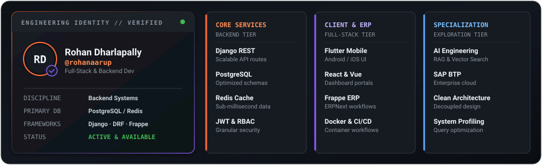
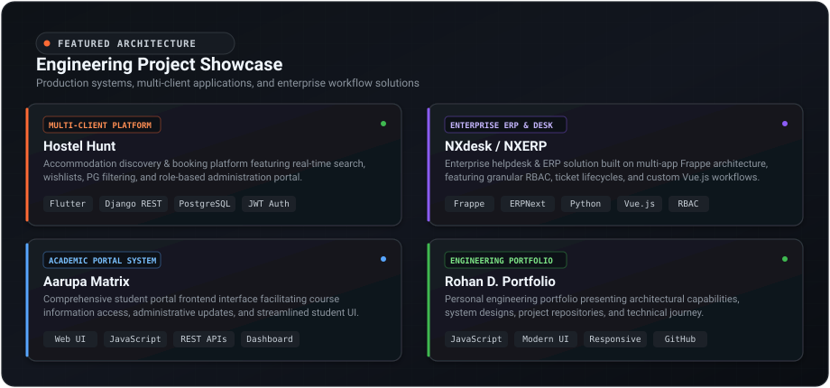
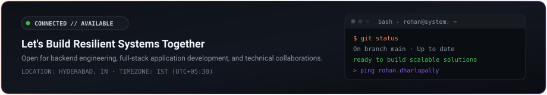

  <!-- ==================== 1. ANIMATED HERO ==================== -->
  

    

  
  
  
  

   

> **Computer Science graduate & Full-Stack Developer** focused on engineering resilient backend architectures, high-concurrency RESTful APIs, and scalable relational schemas. Experienced in end-to-end development spanning database modeling, granular access control, enterprise ERP multi-app workflows, and cross-platform clients. Strengthening core backend engineering while actively exploring **AI Engineering (RAG)** and **SAP Business Technology Platform (SAP BTP)**.

---

### ⚡ What I Build &amp; Architecture Disciplines

  

 

---

### 🪐 Technology Orbital Matrix

  
<em>Real-time synchronized orbital view of core technologies revolving around a central backend engineering kernel.</em>

  

  *Note: A lightweight fallback animation is also compiled in <code>assets/tech-orbit.gif</code> for universal display environments.*

 

---

### 📊 Developer Dashboard &amp; Telemetry

  

    

  <!-- Live GitHub Statistics (Real Data Directly from GitHub API) -->
  
  &nbsp;
  

 

---

### 🚀 Featured Engineering Showcase

  

 

#### 1. [Hostel Hunt](https://github.com/rohanaarup/Hostel-hunt-app) — Multi-Client Accommodation Discovery Platform
*A multi-client PG and hostel discovery system designed to streamline real-time search, filtering, and booking management.*
- **Mobile Client:** Built with **Flutter & Dart**, featuring reactive state management, interactive map views, wishlists, and booking flows.
- **Backend & REST API:** Engineered with **Django & Django REST Framework**, powered by a relational **PostgreSQL** schema.
- **Administration Panel:** Dedicated **React** dashboard with **JWT authentication** and role-based accommodation management.
- **Repositories:** [Mobile App Repository](https://github.com/rohanaarup/Hostel-hunt-app) · [Backend & Admin Repository](https://github.com/rohanaarup/hostel-hunt-admin-pannel)

#### 2. [NXdesk / NXERP](https://github.com/rohanaarup) — Enterprise Helpdesk & ERP Workflow Suite
*Enterprise-grade business solutions built on a modular multi-app architecture.*
- **Framework & Core:** Implemented with **Frappe Framework** and **ERPNext** on top of a **Python** backend.
- **Interface & Interactions:** Reactive user interfaces customized using **Vue.js** for ticketing lifecycles and business transactions.
- **Security & Integrity:** Granular Role-Based Access Control (RBAC), audit logging, automated notification hooks, and CI/CD pipelines.

#### 3. [Aarupa Matrix](https://github.com/rohanaarup/aarupa-matrix-portal-ui) — Academic & Student Portal System
*A responsive student portal interface bridging academic tracking and administrative workflows.*
- **Frontend Architecture:** Modern component-driven interface built for high responsiveness and accessibility.
- **Integration:** Consumes unified REST APIs for timetable schedules, course updates, and student profile verification.
- **Repository:** [Aarupa Matrix Portal UI](https://github.com/rohanaarup/aarupa-matrix-portal-ui)

#### 4. [Personal Portfolio](https://github.com/rohanaarup/Rohan-D-portfolio) — Developer Engineering Showcase
*Interactive developer portfolio presenting architectural capabilities and technical project case studies.*
- **Design & Performance:** Lightweight, dark charcoal engineering layout optimized for high performance and fast load times.
- **Repository:** [Portfolio Repository](https://github.com/rohanaarup/Rohan-D-portfolio)

 

---

### 🏙️ Architectural Contribution Matrix &amp; Activity

  <!-- Isometric 3D Skyline Visual -->
  

    

  <!-- Live Dynamic Activity Graph (Verified GitHub Data) -->
  

 

---

### 💼 Technical Experience &amp; Architecture Focus

<table>
  <tr>
    <td width="50%" valign="top">
      <h4>🛠️ Primary Core Disciplines</h4>
      <ul>
        <li><strong>Languages:</strong> Python, Dart, JavaScript, TypeScript, SQL</li>
        <li><strong>Backend Frameworks:</strong> Django, Django REST Framework, Frappe Framework</li>
        <li><strong>Database Engines:</strong> PostgreSQL, Redis (Caching/Queues), SQLite, Supabase</li>
        <li><strong>Frontend &amp; Mobile:</strong> Flutter, React, Vue.js, Tailwind CSS</li>
        <li><strong>DevOps &amp; Infrastructure:</strong> Docker, Git, GitHub Actions, Postman, Render</li>
      </ul>
    </td>
    <td width="50%" valign="top">
      <h4>🎯 Current Focus &amp; Research</h4>
      <ul>
        <li><strong>Backend Optimization:</strong> Schema indexing, query tuning &amp; caching strategies</li>
        <li><strong>AI Engineering:</strong> Retrieval-Augmented Generation (RAG) &amp; vector search</li>
        <li><strong>Enterprise Platforms:</strong> SAP Business Technology Platform (SAP BTP)</li>
        <li><strong>Architecture Standards:</strong> Decoupled services, event-driven tasks &amp; RBAC</li>
      </ul>
    </td>
  </tr>
</table>

 

---

### 📬 Connect &amp; Collaborate

  

    

  
  &nbsp;
  
  &nbsp;
  
  &nbsp;
  

    

  
    Designed with charcoal engineering aesthetics, pure SVG animations &amp; semantic GitHub Markdown. 
    <strong>© 2026 Rohan Dharlapally</strong> · All assets rendered via relative paths.
  

